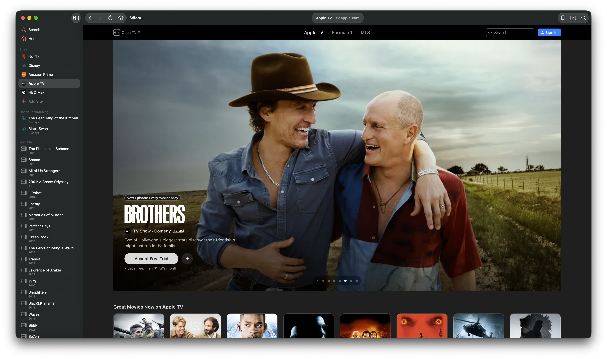

<p align="center">
  <picture>
    <source media="(prefers-color-scheme: dark)" srcset="Assets/wianu-logo.svg">
    
  </picture>
</p>

<div align="center">


</div>

<p align="center">
  All your streaming. One home.
</p>



A macOS app for keeping streaming websites, shows, and movies in one place.
Browse your services, search across them and keep a watchlist.

Requires macOS 26 or later and an account with each streaming service you use.
Playback depends on the provider, your subscription and your region.

## Getting started

1. Open Wianu and select **Add Site** in the sidebar.
2. Enter the site's name and URL.
3. Add a search URL containing `{query}` if you want to search the site from
   Wianu, for example `https://example.com/search?q={query}`. Known sites may
   receive a suggestion automatically.
4. Sign in and use the site as you would in a browser.

## Continue Watching

Recognized titles are added automatically after 30 seconds of playback.
You can also save pages manually, rename entries, or remove them.
Your streaming service handles resume progress across devices.

## Watchlist

Use the bookmark button to save a movie from its page, or select **Add Movie**
in the sidebar to enter it manually.

To import a Letterboxd watchlist, export your data from Letterboxd, select
**Import Letterboxd CSV…** under Watchlist, and choose the watchlist CSV file.

## Development

Open `Wianu.xcodeproj` in Xcode and build the **Wianu** scheme. Swift Package
Manager resolves dependencies automatically.

Or build from the command line:

```bash
make build
```

Run the checks before submitting a change:

```bash
make check
```

This runs SwiftFormat, SwiftLint, and the tests. Install the formatting tools
with Homebrew:

```bash
brew install swiftformat swiftlint
```

Run `make help` for all available commands.

## Privacy

Sites, Continue Watching links, and watchlist items are stored locally on your
Mac. Sign-in and playback happen in the embedded browser. Movie and TV metadata
comes from Wianu's backend.

Wianu sends anonymous feature events to a self-hosted Umami instance. You can
turn analytics off in **Settings → General**.

## Feature requests

Share ideas using the [feature request template](.github/ISSUE_TEMPLATE/feature-request.md).

## License

See [LICENSE](LICENSE).
