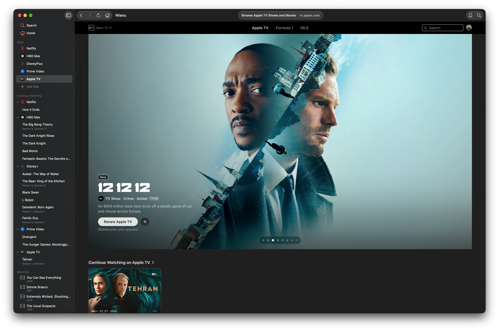

<p align="center">
  <picture>
    <source media="(prefers-color-scheme: dark)" srcset="Assets/wianu-logo.svg">
    
  </picture>
</p>

<div align="center">


</div>

<p align="center">
  All your streaming. One home.
</p>



A macOS app for keeping streaming websites, shows, and movies in one place.
Browse your services, search across them and keep a watchlist.

Requires macOS 26 or later and an account with each streaming service you use.
Playback depends on the provider, your subscription and your region.

## Getting started

1. Open Wianu and select **Add Site** in the sidebar.
2. Enter the site's name and URL.
3. Optionally add a search URL, such as `https://example.com/search?q={query}`.
   Wianu suggests one for known sites.
4. Sign in and use the site as you would in a browser.

## Continue Watching

Continue Watching shows titles from supported services in the sidebar.
Click refresh to update them. Lists are saved on your Mac.
Your streaming service syncs playback progress across devices.

## Watchlist

Click the bookmark button to save a movie.
Use **Add Movie** in the sidebar to enter one manually.

To import from Letterboxd:

1. Export your Letterboxd data.
2. Select **Import Letterboxd CSV…** under Watchlist.
3. Choose your watchlist CSV file.

## Development

Open `Wianu.xcodeproj` in Xcode. Build the **Wianu** scheme.

Or build from the command line:

```bash
make build
```

Install the development tools:

```bash
brew install swiftformat swiftlint
pnpm install --frozen-lockfile
```

Run checks before submitting a change:

```bash
make check
```

This checks formatting, lint, and tests.
Use `make format` to format Swift and JavaScript, or `make lint` to check them.

The app tools and `Website` share one pnpm workspace and lockfile.
Start the website with `pnpm --filter website dev`.

Run `make help` to see all commands.

## Privacy

Your sites, Continue Watching lists, and watchlist stay on your Mac.
Sign-in and playback happen in the embedded browser.
Movie and TV metadata comes from Wianu's backend.

Wianu sends usage events to self-hosted Umami by default. Turn analytics off in
**Settings → General**. See the [privacy policy](https://wianu.com/privacy-policy#app-analytics)
for details about the data collected.

## Feature requests

Share ideas using the [feature request template](.github/ISSUE_TEMPLATE/feature-request.md).

## License

See [LICENSE](LICENSE).
